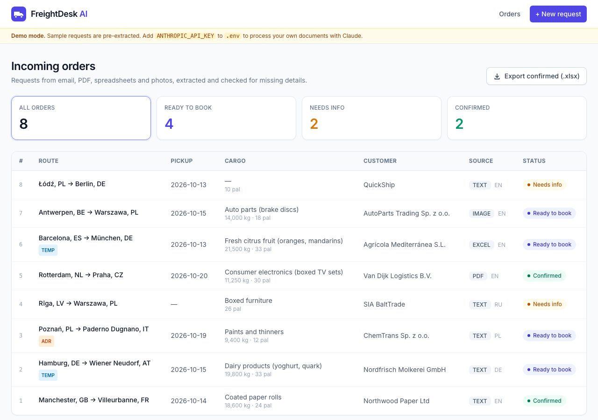
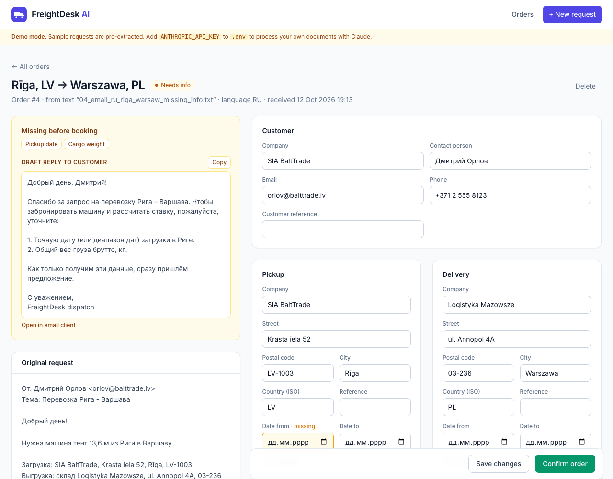
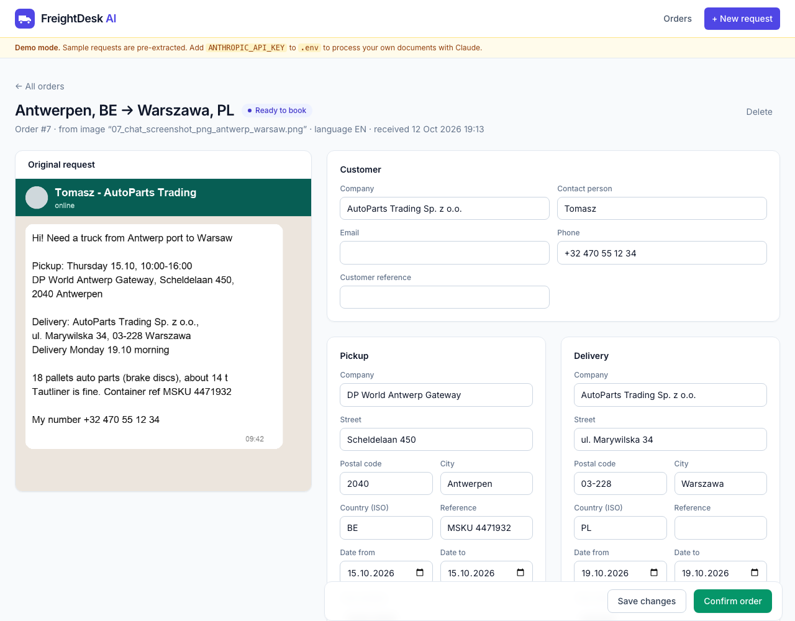

# FreightDesk AI

An AI intake agent for road freight dispatchers. It turns transport requests that arrive as
emails, PDF transport orders, Excel booking sheets or phone screenshots, in any language,
into structured orders a dispatcher can check and book in one click.

**Live demo: [freightdesk-ai.onrender.com](https://freightdesk-ai.onrender.com)** (runs on sample
requests; the free server may take up to a minute to wake up on the first visit)



## The problem

A forwarding dispatcher retypes every request into the TMS by hand: addresses, dates, pallets,
weights, ADR details, temperature ranges. Requests come in five formats and four languages, and
a third of them are missing something, which means another email and another wait.

## What it does

- **Reads any format.** Pasted email text, `.eml`, PDF, `.xlsx`, PNG/JPG photos and screenshots.
- **Extracts a complete order.** Customer, pickup and delivery (company, address, ISO country,
  dates, time windows, references), cargo (description, weight, pallets, LDM, stackability),
  ADR class and UN number, temperature range, vehicle type, price and notes.
- **Normalises as it goes.** Relative dates ("tomorrow", "Thursday") become real dates,
  tonnes become kilograms, countries become ISO codes, cargo is described in English.
- **Checks what is missing before booking.** Missing pickup date, weight, ADR class for dangerous
  goods, temperature for reefer loads, and so on. The order is flagged *Needs info* and the agent
  drafts a reply to the customer **in the customer's language**, asking for exactly those details.
- **Keeps a human in the loop.** The dispatcher sees the original request next to the extracted
  fields, fixes anything, and confirms. Nothing is booked automatically.
- **Exports confirmed orders** to Excel, and exposes them as JSON at `/api/orders` for a TMS.

| Missing details: reply drafted in Russian | Order read from a chat screenshot |
|---|---|
|  |  |

## How it works

```
upload / paste ──► documents.py ──► extractor.py ──► schema check ──► SQLite ──► dashboard
                   PDF → document     Claude API       required          orders     edit, confirm,
                   image → image      structured       fields, ADR,                 export .xlsx
                   xlsx → text        output           temperature
                   eml → text         (Pydantic)
```

- **Claude API with structured outputs.** The extractor calls `messages.parse` with the
  `FreightOrder` Pydantic model as the output format, so every response is schema-valid JSON;
  no regex parsing of model text. PDFs and images are sent natively as document and image blocks.
- **Deterministic validation on top.** Whether an order is bookable is decided by code
  (`schema.missing_fields`), not by the model, so status never depends on a model judgement call.
- **Prompt caching** on the system prompt and a server-side refusal fallback are enabled.
- **Stack:** Python 3.12, FastAPI, Jinja2 + Tailwind, SQLite, openpyxl, Anthropic Python SDK.

## Run it

```bash
uv venv --python 3.12 && source .venv/bin/activate   # or: python3.12 -m venv .venv
uv pip install -r requirements.txt                     # or: pip install -r requirements.txt
cp .env.example .env
python -m app.seed                                     # load 8 sample requests
uvicorn app.main:app --reload
```

Open http://localhost:8000.

**Demo mode.** With no `ANTHROPIC_API_KEY` in `.env`, the app runs on the bundled sample
requests (`samples/inputs`) with pre-extracted results (`samples/expected`), so you can explore
the whole workflow without an API key. Add a key to process your own documents with Claude.

## Deploy a public demo

`render.yaml` deploys the app to [Render](https://render.com) as a free web service: create a
new Blueprint from this repository and Render picks up the settings. The hosted demo runs with
`FREIGHTDESK_DEMO=1` (always demo mode, even if a key is set, so visitors can never trigger paid
API calls) and `FREIGHTDESK_SEED_ON_START=1` (an empty database is filled with the sample orders
on startup, so the demo resets itself after every restart).

## Samples

| Request | Format | Language | Notes |
|---|---|---|---|
| Manchester → Lyon | email | EN | complete |
| Hamburg → Wien | email | DE | reefer, +2..+6 °C |
| Poznań → Milano | email | PL | ADR class 3, UN 1263 |
| Riga → Warszawa | email | RU | missing pickup date and weight |
| Rotterdam → Praha | PDF transport order | EN | slot booking, high-value goods |
| Barcelona → München | Excel booking sheet | EN | reefer, citrus fruit |
| Antwerpen → Warszawa | chat screenshot | EN | read from an image |
| Łódź → Berlin | one-line email | EN | missing cargo and weight |

Regenerate the PDF, spreadsheet and screenshot with `python samples/make_samples.py`
(needs `requirements-dev.txt`).

## Tests

```bash
uv pip install -r requirements-dev.txt
pytest
```

Covers document conversion for every format, the missing-field rules, the full
upload → edit → confirm → export flow, and the Claude request shape (with the API mocked).

## Configuration

| Variable | Default | Purpose |
|---|---|---|
| `ANTHROPIC_API_KEY` | empty | Enables live extraction; demo mode when empty |
| `CLAUDE_MODEL` | `claude-opus-5-5` | Model used for extraction |
| `CLAUDE_EFFORT` | `medium` | Reasoning effort: `low` is cheaper and faster for simple emails |
| `FREIGHTDESK_DATA` | `./data` | Where the SQLite database and uploads are stored |
| `FREIGHTDESK_DEMO` | empty | `1` forces demo mode (hosted demo) |
| `FREIGHTDESK_SEED_ON_START` | empty | `1` loads the sample orders into an empty database at startup |

## Ideas for production

Inbox polling (IMAP / Microsoft Graph) instead of manual upload, push to the customer's TMS,
price suggestion from historical lanes, and an eval set of real requests to track extraction
accuracy over time.
